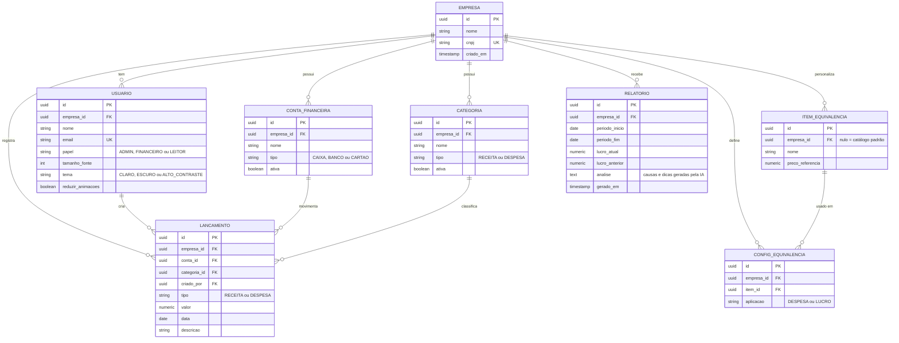

# Finance

> Gestão de contas e despesas para empresas, com resultados explicados em objetos do mundo real e relatórios com apoio de IA.

| Campo | Informação |
|---|---|
| **Versão** | v0.1.0 |
| **Data** | 12/11/2026 |
| **Scrum Master** | Filipe A. Reis |
| **Colaboradores** | Vinicius E. Pini e Pedro H. C. de Oliveira |
| **Professor(a)** | Diogo T. Barbosa |
| **Instituição / Curso** | SENAI / Desenvolvimento de Sistemas |
| **Repositório** | [link do GitHub] |

---

## 1. Apresentação e introdução👆

### 1.1 Problema

Pequenas e médias empresas precisam controlar receitas e despesas, mas os sistemas disponíveis costumam ter três problemas:

- **Números difíceis de interpretar:** dizer que a empresa gastou R$ 48.000 no mês não deixa claro se isso é muito ou pouco.
- **Relatórios que mostram o quê, mas não o porquê:** o gestor vê que o lucro caiu, mas precisa descobrir sozinho a causa.
- **Pouca acessibilidade:** poucos sistemas empresariais pensam em pessoas com deficiência visual, motora ou cognitiva.

### 1.2 Solução proposta

O **Finance** é uma aplicação web de gestão de contas e despesas empresariais. Além do controle financeiro tradicional (receitas, despesas, categorias e contas), ele oferece três diferenciais:

1. **Equivalências personalizadas:** o cliente escolhe uma unidade para ver seus números. Exemplo: *"Despesas do mês: 12 iPhones (R$ 48.000)"*.
2. **Relatórios explicativos com IA:** a cada período, a IA analisa os dados e diz por que o lucro subiu ou caiu, com dicas para melhorar.
3. **Acessibilidade:** ajuste de fonte, alto contraste, navegação por teclado e gráficos com alternativa em texto.

### 1.3 Objetivos

- Permitir o registro e a organização de receitas, despesas e contas.
- Exibir os resultados em equivalências escolhidas pelo cliente.
- Gerar relatórios que expliquem as variações do lucro.
- Seguir boas práticas de acessibilidade (WCAG 2.1 AA).

### 1.4 Público-alvo

Pequenas e médias empresas, gestores e empreendedores que precisam de controle financeiro simples, sem conhecimento contábil avançado.

---

## 2. Requisitos funcionais

**Prioridade:** **M** = essencial · **S** = importante · **C** = desejável

| ID | Requisito | Prior. |
|---|---|---|
| RF01 | Cadastro e login de usuários com e-mail e senha. | M |
| RF02 | Cadastro da empresa ao criar a conta; o usuário vira administrador. | M |
| RF03 | Cadastro, edição e desativação de **contas financeiras** (caixa, banco, cartão). | M |
| RF04 | Cadastro, edição e desativação de **categorias** de receita e despesa. | M |
| RF05 | Registro de **receitas e despesas** com valor, data, categoria, conta e descrição. | M |
| RF06 | Edição e remoção de lançamentos. | M |
| RF07 | Filtro e pesquisa de lançamentos por período, categoria, conta e tipo. | M |
| RF08 | **Painel** com receitas, despesas, lucro e saldo do período. | M |
| RF09 | **Catálogo de itens de equivalência** (ex.: iPhone, máquina nova) com preço de referência. | M |
| RF10 | Escolha do item de equivalência usado para **despesas** e do usado para **lucro**. | M |
| RF11 | Cadastro de itens de equivalência próprios pela empresa. | S |
| RF12 | Exibição do valor em equivalência **junto** ao valor em reais. | M |
| RF13 | Geração de **relatório de análise** comparando o período atual com o anterior, com as causas da variação do lucro e dicas práticas. | M |
| RF14 | Histórico de relatórios gerados. | S |
| RF15 | Ajuste de **tamanho da fonte**, **tema** (claro, escuro, alto contraste) e **redução de animações**. | M |
| RF16 | Gráficos com descrição em texto e tabela de dados equivalente. | M |
| RF17 | Exportação de lançamentos em CSV. | C |

---

## 3. Requisitos não funcionais

| ID | Categoria | Requisito |
|---|---|---|
| RNF01 | **Acessibilidade** | Seguir WCAG 2.1 nível AA: contraste mínimo de 4,5:1, navegação por teclado, foco visível e compatibilidade com leitores de tela. |
| RNF02 | **Desempenho** | Páginas principais carregando em até 3 segundos. |
| RNF03 | **Segurança** | Comunicação via HTTPS, senhas com hash (Supabase Auth) e acesso aos dados protegido por Row Level Security (RLS). |
| RNF04 | **Privacidade** | À IA são enviados apenas dados agregados (totais por categoria e período), nunca descrições ou nomes. Tratamento de dados conforme a LGPD. |
| RNF05 | **Usabilidade** | Interface em português do Brasil. Registrar um lançamento em até 3 interações a partir do painel. |
| RNF06 | **Responsividade** | Funcionar em telas de 360 px a 1920 px. |
| RNF07 | **Compatibilidade** | Funcionar nas duas últimas versões de Chrome, Firefox, Edge e Safari. |
| RNF08 | **Manutenibilidade** | Código em TypeScript, com ESLint e Prettier, e testes nas regras de negócio principais. |

---

## 4. Diagrama de entidades e relacionamentos (DER)

**Observações:**

- Itens de equivalência com `empresa_id` nulo formam o **catálogo padrão**; os com `empresa_id` preenchido são **personalizados** da empresa.
- `CONFIG_EQUIVALENCIA` define qual item é usado para despesas e qual é usado para lucro (RN10).
- As preferências de acessibilidade ficam no próprio `USUARIO` para simplificar o modelo.